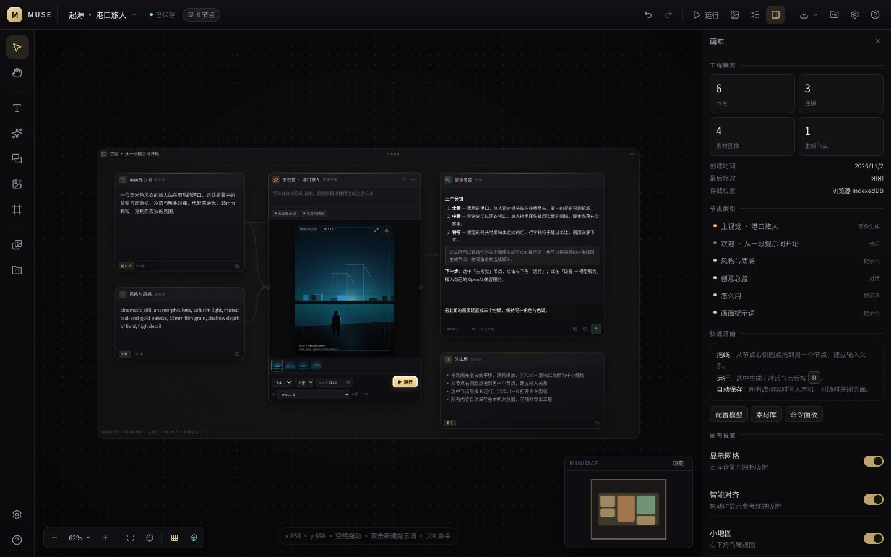

# MUSE Canvas · 缪斯画布

一张本地优先的节点式 AI 创作画布。把提示词、参考图、图像生成与对话模型连成一条可复用的创作流水线，在一张无限画布上完成从灵感到成品的迭代。



它不是演示壳：节点连接会真实改变下游上下文，生成结果会进入素材库并写回文档，所有编辑可撤销、可持久化、可导出迁移。

---

## 快速开始

```bash
cd apps/muse-canvas
npm install
npm run dev          # http://localhost:5175
```

生产构建与本地预览：

```bash
npm run build        # tsc --noEmit + vite build
npm run preview      # 预览 dist，同样监听 5175
```

要求 Node.js ≥ 20。应用完全运行在浏览器里，不需要后端即可启动；接入在线模型时由浏览器直接请求你配置的 OpenAI 兼容服务。

---

## 它能做什么

### 画布

- 无限画布：空格拖动 / 中键拖动平移，滚轮平移，`⌘/Ctrl + 滚轮` 或触控板捏合缩放。
- 框选、多选、对齐、等距分布、分组 / 取消分组；分组拖动时成员跟随。
- 点阵网格、智能吸附与对齐参考线、缩放范围 15%–300%。
- 小地图、适应画布、适应选择、100% 视图。
- 完整的撤销 / 重做（手势合并为单条历史），自动保存与离开前保存。
- 命令面板（`⌘/Ctrl + K`）、右键菜单、节点快捷菜单、批量运行。

### 节点

| 类型 | 用途 |
| --- | --- |
| 提示词 Prompt | 正向 / 风格 / 负面 / 备注四栏，可连接到生成或对话节点 |
| 图像 Image | 上传、粘贴或从素材库插入的参考图 / 成品图 |
| 视频 Video | 素材节点，可插入画布、整理与导出；当前不参与生成上下文 |
| 音频 Audio | 素材节点，可插入画布、整理与导出；当前不参与生成上下文 |
| 图像生成 Generate | 选择模型、比例、数量、种子；支持参考图与批量结果 |
| 对话 Chat | 流式对话、Markdown、上游文本 / 图片作为上下文 |
| 分组 Group | 框住一组节点，整体移动与折叠视觉层级 |

管线规则：

- 上游文本按连接层级由近及远自动拼接为下游提示词；提示词节点按「正向 / 风格 / 负面」分别参与合成。
- 上游图像会成为生成节点的参考图；接入支持 `images/edits` 的模型时可直接做图生图。
- 连线有方向、可选中删除，并做环检测，避免工作流成环。
- 生成 / 对话节点可设置「自动运行」；连线后自动执行，适合搭建批量流水线。
- 运行整张画布会按拓扑顺序执行所有可运行节点。

### 生成与任务

- 比例：1:1、4:5、3:4、2:3、16:9、9:16、3:2、21:9。
- 单次 1–4 张，支持固定种子复现；每张结果保留提示词、模型、种子、尺寸与耗时。
- 生成中可取消；失败会保留错误信息与重试入口。
- 任务中心展示排队 / 运行 / 完成 / 失败状态；并发生成数可配置（1–4）。
- 结果自动写入素材库，节点只保存 `assetId`，避免文档膨胀。

### 对话

- OpenAI 兼容的 SSE 流式输出，逐字渲染。
- 自动带入上游文本与参考图；可开启「支持图像理解」发送视觉输入。
- 输出可直接作为下游生成节点的提示词来源。

### 本地优先

- 工程文档、节点、画布视角保存在 IndexedDB（库名 `muse-canvas`）。
- 原始素材以 Blob 存 IndexedDB，设置与 API Key 存 `localStorage`（`muse.settings.v1`）。
- 自动保存 700ms 防抖；顶部实时显示「已保存 / 保存中 / 未保存」。
- 画布库支持新建、复制、删除、切换工程，并保存项目缩略图。
- 模板：分镜工作流、角色设定、电商主图、空白画布。

### 迁移与交付

- 导出工程（含素材）：单个 JSON，素材内联为 data URL，可在另一台设备完整导入。
- 导出工程（轻量）：只含文档结构，适合版本管理与 diff。
- 导入工程时自动分配新工程 ID，不会覆盖现有画布。
- 导出 PNG：整张画布（自动适配）或当前视图；导出时自动隐藏 HUD、小地图、选中框等界面元素。

---

## 接入模型

打开 `设置 → 模型服务`。默认使用内置的「离线样例引擎」，无需 Key：

- `muse-1`：通常 1–4 秒出图（取决于设备与画布尺寸），用于熟悉画布与流程调试。
- `muse-1-turbo`：更快的出图节奏。
- `muse-chat`：结构化的离线创意回复。

离线引擎是一个**确定性的程序化图像生成器**：读取提示词中的色彩与题材线索（港口、人物、风景、建筑、产品、抽象等），映射成海报化构图。它会真实走完「提示词 → 上下文合成 → 生成 → assetId → 下游节点」的整条链路，但**不是 AI 模型**，不应被当作生成质量的参考。

接入真实服务：

1. 在预设中点选 OpenAI / OpenAI 对话 / DeepSeek / 通义千问 / 本地 Ollama，或手动新增任意 OpenAI 兼容服务。
2. 填写 `Base URL`（例如 `https://api.openai.com/v1`）、`API Key`、模型名（逗号分隔）。
3. 点击「测试连接」调用 `/models` 验证，不会产生生成费用。
4. 在画布或设置中选择默认图像 / 对话模型。

### 兼容范围

- 图像：OpenAI Images API（`/images/generations`、`/images/edits`），支持 `b64_json` 与 URL 结果；对 `dall-e-3` 自动映射到其支持的尺寸。
- 对话：OpenAI Chat Completions（流式 SSE）。
- 视觉：设置 `vision` 后，参考图以 `image_url` 形式发送。

### 关于 Key 与 CORS

Key 仅写入当前浏览器的 `localStorage`，不会上传到本项目的任何服务器。请使用专用 Key，并避免在共享电脑上保存。

浏览器会直接请求你填写的 Base URL，因此该服务必须允许跨域（CORS）。若服务商不返回 CORS 头，浏览器会拦截请求，界面会提示「无法连接服务（可能是网络、CORS 或 Base URL 配置问题）」。此时请填写一个允许跨域的转发地址，或在部署层加同源代理。生产环境不要把带 Key 的代理暴露给公网。

---

## 快捷键

`⌘` 在 Windows / Linux 上对应 `Ctrl`。

| 操作 | 快捷键 |
| --- | --- |
| 命令面板 | `⌘/Ctrl + K` |
| 保存 | `⌘/Ctrl + S`（亦自动保存） |
| 撤销 / 重做 | `⌘/Ctrl + Z` / `⇧ + Z` 或 `⌘/Ctrl + Y` |
| 全选 / 复制 / 粘贴 / 复制节点 | `⌘/Ctrl + A` / `C` / `V` / `D` |
| 分组 / 取消分组 | `⌘/Ctrl + G` / `⇧ + G` |
| 删除 | `Delete` / `Backspace` |
| 运行选中节点 / 整张画布 | `R` / `⇧ + R` |
| 适应画布 / 100% | `⌘/Ctrl + 0` / `1` |
| 适应选择 | `⇧ + 1` |
| 缩放 | `⌘/Ctrl + 滚轮` / 捏合 |
| 平移 | 空格拖动 / 滚轮 / `H` |
| 选择工具 | `V` |
| 新建提示词 | 双击空白处 / `T` |
| 新建生成节点 | `G` |
| 新建对话节点 | `C` |
| 帮助 | `?` / `Esc` 关闭浮层 |

节点标题栏右侧有运行与更多菜单；选中节点后底部出现对齐、分组、复制、删除工具条。

---

## 项目结构

```
apps/muse-canvas/
├─ src/
│  ├─ model/        # 类型、工厂、几何、图算法、序列化、模板
│  ├─ store/        # IndexedDB、素材、设置、UI 状态、编辑器、会话
│  ├─ runtime/      # 模型适配器、生成 / 对话运行时、并发限制、离线引擎
│  ├─ ui/           # 画布、节点视图、面板、命令面板、设置、画布库
│  ├─ lib/          # 工具、Markdown、导出、插入、素材操作
│  ├─ styles/       # base / canvas / nodes / panels
│  └─ test/         # Vitest + Testing Library
├─ docs/preview.jpg
├─ vite.config.ts
└─ package.json
```

### 关键设计

- **文档与视图分离**：`CanvasDoc` 只含节点与边；相机、选择、面板状态独立。撤销栈只记录文档变更，不记录平移缩放。
- **手势合并**：拖动、缩放、批量移动在 pointerdown 时建立快照，pointerup 时提交为一条撤销记录。
- **素材引用**：节点只存 `assetId`；素材独立存 IndexedDB，导出时按引用内联，避免同一张图被复制多份。
- **生成任务归属**：每次运行带 `taskId`，异步结果返回时校验归属；取消、切换工程或撤销后不会把旧结果写回新文档。
- **可替换的 Provider**：UI 只依赖 `ProviderAdapter` 形状，新增服务不需要改画布逻辑。
- **可靠性细节**：节点拖拽在超过 3px 后才捕获指针，避免吞掉 click / dblclick；缩略图先打开画布库再后台生成；`StrictMode` 下用单例 Promise 初始化，防止重复创建示例工程。

---

## 测试与质量

```bash
npm run typecheck    # tsc --noEmit（strict）
npm run test         # vitest run
npm run build        # 类型检查 + 生产构建
```

当前 13 个测试覆盖：

- 几何：屏幕 / 世界坐标互转、缩放、适配、吸附与参考线。
- 图算法：上下文收集、提示词合成、连线合法性、环检测、拓扑排序、分组、复制子图。
- 序列化：工程往返、版本迁移、非法输入处理。
- 应用冒烟：首次启动创建示例工程、添加节点、撤销、命令面板。

浏览器端已用无头 Chromium 做过完整交互回归：启动、选择节点、运行生成、双击查看大图、拖拽连线、拖拽移动、撤销 / 重做、保存后刷新恢复、素材上传与插入、导入导出工程、导出 PNG、设置、画布库、模板、命令面板、右键菜单、任务中心、帮助浮层。导出截图已验证不包含 HUD / 小地图等界面元素。

---

## 已知边界

- 单用户、单浏览器：没有账号、云同步与多人协作；跨设备依靠工程文件迁移。
- 内置生成能力聚焦图像与对话；视频 / 音频目前是素材节点，不包含视频生成适配器。
- 浏览器直连第三方 API 受 CORS 与网络策略限制，见上文。
- IndexedDB 有站点配额；大量高清素材会占用空间，建议定期导出工程并清理素材。
- 离线样例引擎是程序化插画，不是模型推理，不代表真实模型效果。

### 可以继续做

视频生成适配器（RunningHub / ComfyUI / 可灵等）、节点子图与复用、提示词版本历史与对比、云端同步、协作光标、批量队列持久化。

---

## 与 AIFISHER 的关系

本应用位于 AIFISHER 仓库的 `apps/muse-canvas`，是一个独立的 Web 应用，可单独运行与部署。交互与数据结构参考了 AIFISHER 画布 2.x 的实践（视口与编辑分层、连线命中区、节点框架、素材与任务模型），但没有复用 Electron 主进程或本地 ComfyUI 服务，因此不依赖桌面端环境。

---

MUSE Canvas · Local first · Built with React 19, TypeScript, Vite.
