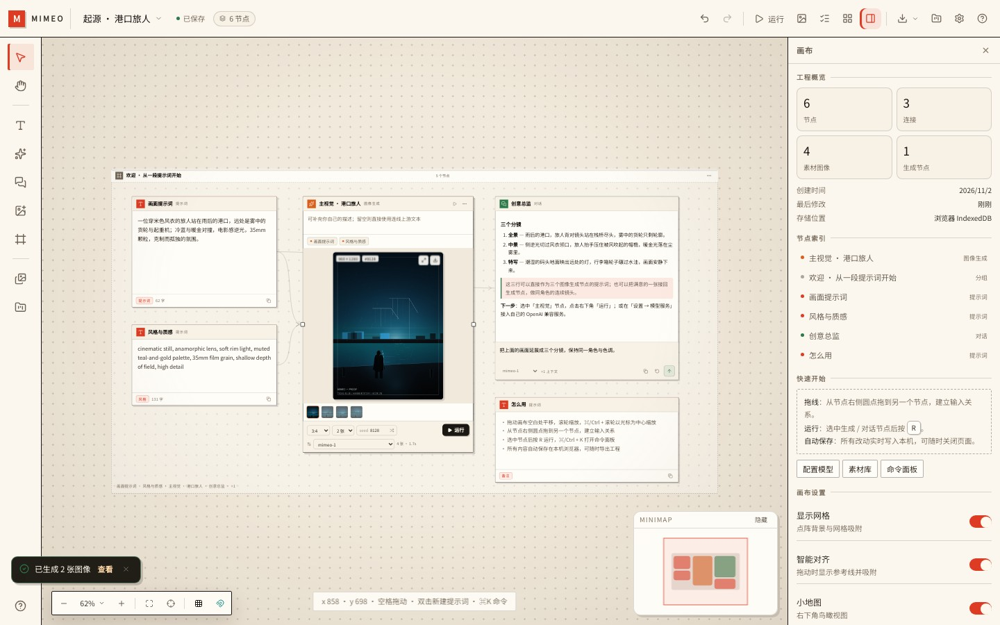
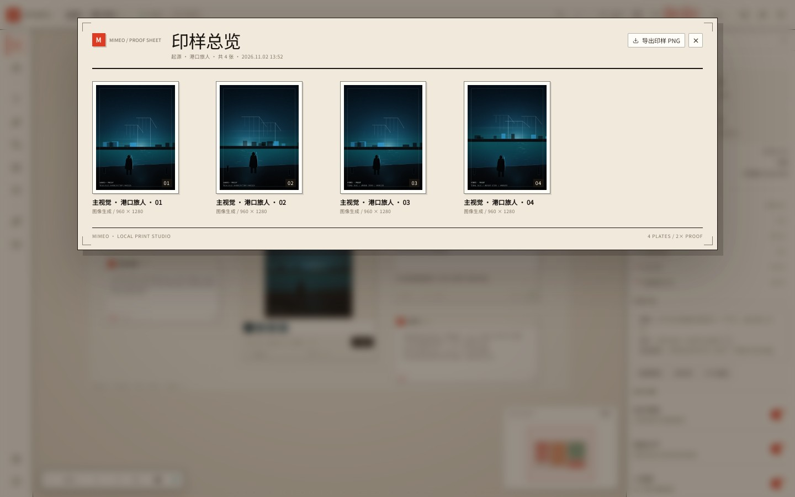

# MIMEO · 复写

**节点式 AI 视觉印坊。** 把提示词、参考图、生成模型与对话模型连接成一条可复用的工序，在一张纸上完成从原稿到印样的全部工作。

MIMEO 是一个独立的 Web 应用，源码位于仓库根目录的 `mimeo/`。它不依赖父仓库的运行时、Electron 主进程或任何本地 ComfyUI 服务，可以单独安装、运行与部署。



---

## 1. 它是什么

大多数 AI 画布把生成结果堆在深色无限画布里。MIMEO 反过来，借用印坊的工作台：

- **纸**：画布是一张有纹理的米色纸，节点是贴在上面的印张。
- **墨**：提示词是朱红，图像是普鲁士蓝，视频是紫，音频是青，生成是橙，对话是绿。每种节点顶部有一条实色墨条。
- **套准**：选中、连线和分组使用硬边偏移阴影与套准线，而不是发光。
- **印样**：按 `Shift + P` 打开印样总览，所有画面按画布位置排成一张可导出的接触印样（contact sheet）。
- **工序**：节点之间的连线不是装饰，而是依赖关系。运行整张画布时，MIMEO 会按拓扑顺序分层执行。

这不是一个 demo 外壳：文档、素材、设置、生成任务、导出与导入都是完整的本地优先实现。

---

## 2. 你能做什么

### 画布

- 无限画布：平移、缩放、框选、按住空格拖拽、`⌘0` 适配全部、`⌘1` 回到 100%。
- 七种节点：提示词、图像、视频、音频、图像生成、对话、分组。
- 拖拽端口连线；支持一对多、多对一与分组折叠。
- 框选多个节点后可对齐、等距分布、打组、复制、撤销。
- 智能参考线、网格吸附、点阵纸背景、可折叠小地图。
- 双击空白处快速插入节点；`⌘K` 打开命令面板。
- 右键菜单、节点右键菜单、属性检查器与素材抽屉。

### 生成

- 图像生成节点支持比例、张数、种子、负面提示词与参考图。
- 上游提示词、风格说明与图像节点会自动拼成上下文，也可以在节点里手动改写。
- 对话节点支持系统提示词、温度、多轮历史与 Markdown 输出。
- 任务中心显示排队、进度、耗时与错误；支持取消、重试。
- 连接后自动运行（可选）、运行选中节点（`R`）、按依赖顺序运行整张画布（`Shift + R`）。
- 并发生成数可在 1–4 之间调整，避免触发服务商限流。

### 印样与交付

- **印样总览**：收集画布上所有图像与生成结果，按位置编号，点击进入大图。
- 印样可导出为 2× PNG，带项目名、张数、时间与印坊页脚。
- 整张画布 PNG / 当前视图 PNG。
- 工程文件导出：轻量 JSON，或包含全部素材的完整 JSON。
- 工程导入后可继续编辑，素材 id 保持不变。
- 作品库自动生成缩略图，可复制、删除、切换原稿。

### 本地优先

- 工程、节点、视口保存在 IndexedDB。
- 素材以原始 Blob 保存在 IndexedDB，节点只存 `assetId`；关闭“保留原图”后会自动压缩大图。
- API Key 只写入 `localStorage`，不上传、不经过任何中间服务。
- 断网也能打开已有工程、编辑、排版和导出。

---

## 3. 快速开始

```bash
cd mimeo
npm install
npm run dev
```

打开 `http://localhost:5175`。

生产构建：

```bash
npm run build
npm run preview
```

类型检查与测试：

```bash
npm run typecheck
npm test
```

---

## 4. 接入真实模型

打开右上角 **设置 → 模型服务**。MIMEO 使用 OpenAI 兼容协议，不绑定特定厂商。

### 图像

- 接口：`POST {baseUrl}/images/generations`
- 必填：`model`、`prompt`、`n`、`size`
- 支持返回 `b64_json` 或 `url`
- `dall-e-3` 只接受 `1024x1024` / `1792x1024` / `1024x1792`，且 `n=1`；MIMEO 会自动映射比例与张数。
- 建议模型：任意 OpenAI 兼容的图像服务、自建网关、本地代理。

### 对话

- 接口：`POST {baseUrl}/chat/completions`
- 支持 `temperature`、多轮 `messages`、视觉模型（开启“支持图像输入”后会附带上游图片）。

### CORS

浏览器会直接请求你填写的 Base URL。若服务商不允许跨域，请使用允许 CORS 的网关或本地反向代理；MIMEO 不会把你的 Key 转发到第三方。

### 离线样例引擎

内置的 `mimeo-1` / `mimeo-1-turbo` / `mimeo-chat` 是**程序化离线样例**，用于在没有 Key 时熟悉画布、连线、任务与导出流程。它们不是真实模型推理，出图结果是按提示词选择的构图与配色，不应作为模型效果评估。

---

## 5. 印样总览

`Shift + P` 或顶栏的田字格按钮。



- 自动收集图像节点与生成节点的全部输出。
- 按画布横坐标排序，编号从 `01` 开始。
- 点击任意印张打开大图，可继续查看提示词、模型、种子与尺寸。
- “导出印样 PNG”会把整张印样装订成一张 2× 图，适合发给导演、客户或存档。

---

## 6. 快捷键

| 操作 | 快捷键 |
| --- | --- |
| 选择 / 抓手 | `V` / `H` |
| 添加提示词 | `T` |
| 添加图像生成 | `G` |
| 添加对话 | `C` |
| 运行选中节点 | `R` |
| 运行整张画布 | `Shift + R` |
| 命令面板 | `⌘K` / `Ctrl+K` |
| 印样总览 | `Shift + P` |
| 保存 | `⌘S` / `Ctrl+S` |
| 撤销 / 重做 | `⌘Z` / `⇧⌘Z` |
| 复制 / 粘贴 / 再制 | `⌘C` / `⌘V` / `⌘D` |
| 全选 | `⌘A` |
| 打组 / 解组 | `⌘G` / `⇧⌘G` |
| 适配全部 | `⌘0` |
| 100% | `⌘1` |
| 删除 | `Delete` / `Backspace` |
| 微调 | 方向键（`Shift` 加速） |
| 帮助 | `?` |

---

## 7. 实现说明

### 数据

- `CanvasDoc` 只保存节点与边；相机、选择、面板状态与文档分离，撤销栈不会记录视角变化。
- 素材二进制不入文档，节点只引用 `assetId`；导出“含素材”时才把 Blob 转成 data URL 内联。
- 文档版本为 `3`，`schema.ts` 集中处理归一化、迁移与校验。
- 工程格式标记为 `mimeo`，导入时会拒绝其他来源的 JSON。

### 生成

- `runtime/providers.ts` 统一封装 OpenAI 兼容的图像与对话请求。
- `runtime/generation.ts` 负责上下文拼装、任务生命周期、错误提示与批量运行。
- `runAllNodes()` 先做拓扑分层，再按层并行；同一层内受并发限制器约束。
- 离线引擎 `runtime/demoEngine.ts` 用 Canvas 2D 绘制程序化构图，支持流式进度与取消。

### 界面

- React 19 + TypeScript + Vite。
- Zustand 风格的轻量 store 使用 `useSyncExternalStore` 订阅，避免全树重渲染。
- 画布手势在指针移动超过阈值后才捕获，保证节点内部的点击与双击可用。
- 导出使用 `html-to-image`；导出前给画布加 `.exporting` 类隐藏浮层、选中框与缩略图按钮。
- 印样导出同样使用 `html-to-image`，但背景固定为纸色。

### 目录

```
mimeo/
├── index.html
├── package.json
├── vite.config.ts
├── docs/preview.jpg
├── docs/contact-sheet.jpg
└── src/
    ├── main.tsx
    ├── model/        # 类型、工厂、几何、图算法、schema、模板
    ├── store/        # IndexedDB、素材、设置、编辑器、会话、UI 状态
    ├── runtime/      # 真实 provider、并发限制、生成流程、离线引擎
    ├── lib/          # 导出、缩略图、素材动作、工具函数
    ├── ui/           # 画布、顶栏、检查器、印样、面板、节点视图
    ├── styles/       # 纸/墨设计系统与四大样式域
    └── test/         # 单元测试与烟雾测试
```

---

## 8. 设计原则

MIMEO 的视觉语言来自实体印坊，而不是常见的深色 AI 工具：

- 纸色底 `#ece4d6`，卡片 `#fffdf8`，墨色 `#191512`。
- 朱红 `#dd3b24` 只用于选中、主操作与印坊标记；六种节点色各自承担一种“油墨”。
- 2px 圆角、1px 实线边框、硬边偏移阴影，模拟纸张叠放与套印偏移。
- 标题使用衬线字体，界面正文使用无衬线；数字与工序标签使用等宽字体。
- 没有霓虹、玻璃拟态、渐变发光；层次由边框、留白与油墨面积建立。

---

## 9. 已知边界

- 视频与音频节点可以上传、预览、下载，但图像生成节点目前只产出图片。
- 远程 URL 素材受目标站点 CORS 限制。
- 所有数据都在当前浏览器；清理站点数据会删除本地工程，请定期导出工程文件。
- 大尺寸素材会占用较多 IndexedDB 空间；可在设置中关闭“保留原图”。

---

## 10. 验证记录

- `npm run typecheck` 通过。
- `npm test`：2 个测试文件、13 个测试通过。
- `npm run build`：生产构建成功。
- 浏览器实测：生成流程、任务中心、撤销、作品库、印样导出、工程导入导出、PNG 导出均可完成。

---

MIMEO · Local first · React 19 + TypeScript + Vite.
