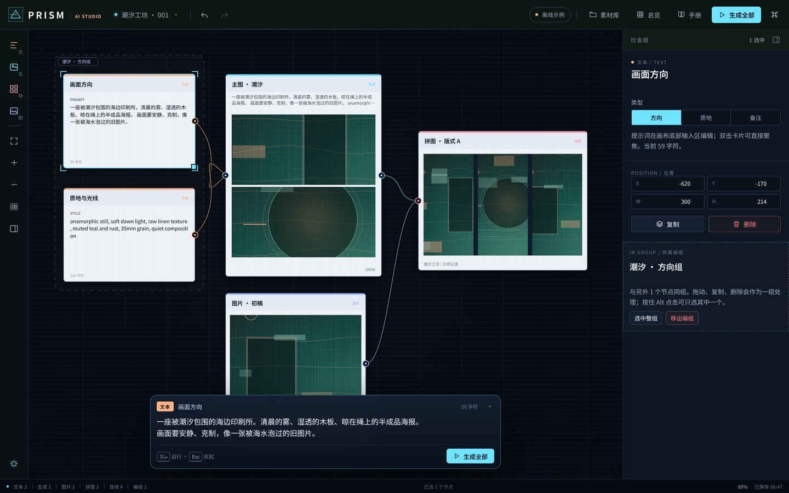

# PRISM · 节点式 AI 图像工作台

PRISM 是一张本机优先的 AI 图像工作流画布：**文本**写提示词，**生成**出图片，**图片**做素材，**拼图**做排版。它面向真实的创作流程，不是一次性 demo。名字取「棱镜」之意：一束提示词进入，拆成多张画面。



> 一套从零实现的画布引擎：Canvas 2D 自绘节点与连线，自己写的图计算、历史记录、IndexedDB 持久化与生成运行时。没有 React，没有 React Flow、Konva、Fabric、Excalidraw，也没有前端运行时依赖。

## 开始

```bash
cd prism
npm install
npm run dev
```

打开 `http://localhost:5180`。生产构建与检查：

```bash
npm run typecheck
npm run test
npm run build
```

## 四种节点

| 节点 | 快捷键 | 作用 |
| --- | --- | --- |
| 文本 TEXT | `T` | 写主体、风格、光线与画面方向。连线后自动成为下游生成节点的提示词。 |
| 生成 GENERATE | `G` | 调用图像模型或离线示例。可设画幅、张数、种子，也可以补充本地提示词。 |
| 图片 IMAGE | `I` | 上传、从素材库放入或拖入画布。双击查看大图与来源信息。 |
| 拼图 COLLAGE | `W` | 收集直接连入的图片，按列数与间距排版，整张导出 PNG。 |

从节点右侧的圆点拖到另一个节点即可连线。连线有方向，会拒绝形成循环的连接；点击线本体可以选中，按退格删除。所有上游文本参与提示词合成：**生成节点的最终提示词 = 所有上游文本（按远近顺序）+ 本地补充**。

## 底部输入区

点击文本或生成节点，画布正下方会浮出对应的输入区：文本节点编辑提示词，生成节点编辑本地补充。输入实时写回节点，`⌘/Ctrl + ↵` 运行，`Esc` 收起；双击节点会直接聚焦输入区。输入区打开时会自动收起小地图和底部操作提示，避免遮挡。

## 连线规则与接口

只有真正能连的接口才会显示：

- **文本**没有左侧输入接口，只能向右接到生成节点。
- **生成**左侧接文本，右侧接拼图。
- **图片**没有左侧输入接口，只能向右接到拼图。
- **拼图**只接收图片或生成，没有右侧输出接口。

连接到不兼容的节点时，预览线会变红并提示原因，不会创建无效连线。

## 选择与编组

- **框选**只选中完全落在框内的节点，擦到边缘不会误选。
- 普通点击只选中一个节点，拖动、复制、删除也只作用于它。
- 点击编组顶部标题带，或按住 `Alt` 点击组内节点，才会选中整组；此时拖动、复制、删除按整组处理。
- 双击编组标题可直接改名；右键标题也能重命名或解散编组。
- `⌘/Ctrl + G` 编组，`⇧⌘G` 解散；左侧工具栏和多选检查器里也有入口，检查器可以改组名。
- 编组只是逻辑容器，不改变连线，也不改变提示词合成。

## 素材管理

- 素材库卡片右上角有删除按钮，图片详情页也有「删除素材」。删除会移除本机文件，并清空画布中引用它的节点（这一步可以撤销）。
- 只想让某个节点不再使用某张图时，用节点右键的「清空生成结果」/「移除图片」，或检查器缩略图右上角的删除按钮；素材本身仍留在素材库。
- 删除会立即写入 IndexedDB，刷新后不会复活。

## 精准点击

画布按 `devicePixelRatio` 渲染，Retina / 高分屏上绘制的节点与鼠标命中坐标始终一致。节点使用圆角矩形命中，四个圆角外的透明区域不会误触；端口、连线、缩放手柄各有固定的屏幕命中半径。

拖动节点或整组时，左/中/右与上/中/下会在 7px 内吸附到其他节点的边缘和中心，并画出青色参考线；缩放后吸附距离保持同样的屏幕手感，拖动时按住 `⌘/Ctrl` 可临时关闭吸附。需要逐像素摆放时，用方向键微调 1px，按住 `Shift` 微调 10px，连续按键只算一次撤销。

## 真实模型，而不是假接口

右上角「设置与接口」支持任意 OpenAI 兼容图像接口：

- `Base URL`，例如 `https://api.openai.com/v1`（不要带 `/images/generations`）
- `API Key`
- 模型名，例如 `gpt-image-1`
- 并行生成数（1–3）

会向 `${BaseURL}/images/generations` 发请求，兼容 `b64_json` 与 `url` 两种返回；遇到不支持一次多张的模型会退化为逐张请求。画幅会映射到 `1024x1024`、`1024x1536`、`1536x1024` 三档。密钥只保存在本机 `localStorage`，不会发送到第三方。

关闭「离线示例」后，如果没有填完接口信息，生成会直接报错，而不是偷偷退回假图。

离线示例使用程序化纹理（叠色、纸浆颗粒、四种母题），不联网，用来在没有 Key 时验证完整链路。

## 本机数据与交换

- 项目、画布、相机自动保存在浏览器 **IndexedDB**（650ms 防抖）。
- 图片二进制同样在 IndexedDB；刷新后仍在。
- **项目 JSON** 会把画布中使用到的图片以 data URL 一并打包，换机器也能完整还原。
- 可导出：项目 JSON、整幅画布 PNG、拼图 PNG、素材总览 PNG。
- 导入 JSON 会校验节点类型、数值范围、悬空连线与编组成员，不信任文件里的任意结构。
- 早期 WEFT / JACQUARD / RELAY 版本的本地项目会在第一次打开时自动迁移，旧 API 设置也会沿用。

## 键盘

| 键 | 动作 |
| --- | --- |
| `⌘/Ctrl + K` | 命令面板 |
| `⌘/Ctrl + S` | 立即保存 |
| `⌘/Ctrl + Z` / `⇧⌘Z` | 撤销 / 重做 |
| `⌘/Ctrl + G` / `⇧⌘G` | 编组 / 解散编组 |
| `T` / `G` / `W` | 新建文本 / 生成 / 拼图节点 |
| `Shift + 点击` | 加选 / 减选单个节点 |
| `Alt + 点击` | 选中整组 |
| 双击组标题 | 重命名编组 |
| `方向键` / `⇧ + 方向键` | 微调选中节点 1px / 10px |
| `I` | 打开素材库 |
| `R` | 生成选中的节点 |
| `⌘/Ctrl + ↵` | 生成全部 |
| `F` | 适应画面 |
| `空格 + 拖` | 平移画布 |
| `⌘/Ctrl + 滚轮` | 缩放 |
| `P` | 素材总览 |
| `⇧P` | 收起 / 展开底部总览条 |
| `?` | 打开使用手册 |

## 代码地图

```text
src/
  core/
    types.ts       文档模型（文本/生成/图片/拼图/编组、画幅、Project）
    editor.ts      选择与编组、连线、防环、提示词合成、事务式撤销栈
    geometry.ts    相机变换、命中测试、贝塞尔线、适应画面、吸附
    paint.ts       纯 Canvas 2D 场景渲染（网格、编组框、节点、线、端口、选择框）
    factory.ts     节点工厂、初始项目、示例提示词
    db.ts          IndexedDB projects / assets 两个 store，旧库迁移
    assets.ts      图片缓存、ObjectURL、图像解码
    schema.ts      导入校验与项目文件格式
    settings.ts    本机接口设置
  runtime/
    runner.ts      单节点 / 多节点生成队列、取消、并发
    provider.ts    OpenAI 兼容图像接口
    demo.ts        离线程序化示例图
    export.ts      项目 JSON、画布 PNG、拼图 PNG
  ui/
    app.ts         外壳、快捷键、自动保存、项目管理
    viewport.ts    指针状态机（框选/拖拽/缩放/连线/平移）、行内编辑
    inspector.ts   参数检查器
    commands.ts    命令面板
    contactsheet.ts 素材总览（Canvas 排版 + PNG）
    library.ts     素材库与详情
    guide.ts       使用手册
    settings.ts    设置弹层
    files.ts       文件选择
    icons.ts       内联 SVG 图标
    toast.ts       轻提示
  styles/app.css   完整视觉系统（墨蓝底 / 冷白纸感卡片 / 青色活线）
  test/core.test.ts 图计算、编组、历史、导入、命中与几何
```

**为什么不用现成画布库**：节点渲染、连线命中、拖拽状态机、缩放、选择框、小地图、导出排版全部自己实现；数据模型、撤销栈、持久化、生成队列也不依赖任何画布产品。这样视觉与交互可以按工作流语义长出来，而不是在别人的节点组件上换皮。

## 已知边界

- 单用户、本机优先；没有账号、云同步、协作。
- 浏览器清站点数据会删除本地项目，请定期导出 JSON。
- 图像生成的排队与重试是克制的：失败会写回节点错误，不会无限重试。
- 小屏幕上检查器是抽屉式覆盖，建议在 ≥ 1024px 宽度下完成主要排版工作。

## 视觉

- 底色：墨蓝；节点：冷白纸感；活线：青色；方向：珊瑚橙。
- 节点、连线、小地图、素材总览、导出画面都来自同一套 Canvas 渲染器，因此画布与成品的视觉一致。

---

PRISM · 在本机完成你的图像工作流。
