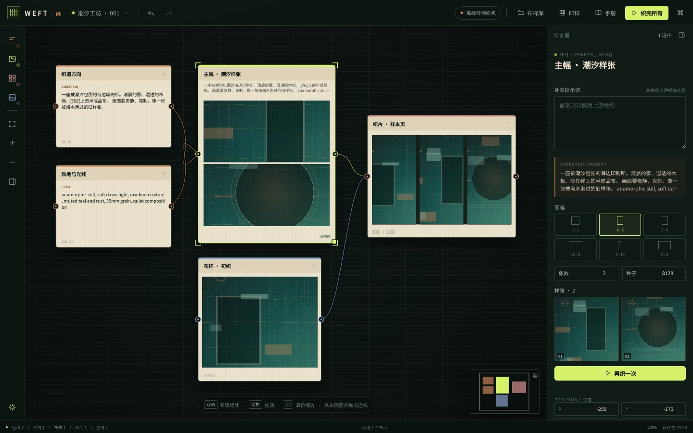

# WEFT 纬 · 节点式 AI 织造台

WEFT 是一台本机优先的 AI 图像织造台：**经线**写方向，**纬线**出样张，**布样**可以入库、拼接，最后收进一块**织片**。它面向真实的创作流程，不是一次性 demo。



> 一套从零实现的画布引擎：Canvas 2D 自绘节点与连线、自己写的图计算 / 历史记录 / IndexedDB 持久化 / 生成运行时。没有 React，没有 React Flow、Konva、Fabric、Excalidraw，也没有前端运行时依赖。

## 起织

```bash
cd weft
npm install
npm run dev
```

打开 `http://localhost:5180`。生产构建与检查：

```bash
npm run typecheck
npm run test
npm run build
```

## 四种节点

| 节点 | 隐喻 | 作用 |
| --- | --- | --- |
| 经线 Prompt | 方向 | 写主体、气氛、质地、光线。连线后自动成为下游纬线的提示词。 |
| 纬线 Render | 样张 | 调用图像模型或离线样例织机。可设画幅、张数、种子，也可以补充本地提示词。 |
| 布样 Image | 素材 | 上传、从布样库放入、拖入画布。双击看大图与提示词。 |
| 织片 Weave | 版 | 收集直接连进来的布样，按列数与间距排版，整块导出 PNG。 |

节点右侧圆点拖到另一个节点即可连线。WEFT 会拒绝成环的连线；点击线本体可以选中，按退格剪断。所有连线参与提示词合成：**纬线的最终提示词 = 所有上游经线（按远近顺序）+ 自己的补充**。

## 真实模型，而不是假接口

右上角「设置与接口」支持任意 OpenAI 兼容图像接口：

- `Base URL`，例如 `https://api.openai.com/v1`（不要带 `/images/generations`）
- `API Key`
- 模型名，例如 `gpt-image-1`
- 并行织机数（1–3）

WEFT 会向 `${BaseURL}/images/generations` 发请求，兼容 `b64_json` 与 `url` 两种返回；遇到不支持一次多张的模型会退化为逐张请求。画幅会映射到 `1024x1024`、`1024x1536`、`1536x1024` 三档。密钥只保存在本机 `localStorage`，不会发送到第三方。

关闭「离线样例织机」后，如果没有填完接口信息，纬线会直接报错，而不是偷偷退回假图。

离线样例织机使用程序化织纹（经线/纬线叠色、纸浆颗粒、四种母题），不联网，用来在没有 Key 时验证完整链路。

## 本机数据与交换

- 工程、画布、相机自动保存在浏览器 **IndexedDB**（650ms 防抖）。
- 布样二进制同样在 IndexedDB；刷新后仍在。
- **工程 JSON** 会把画布中使用到的布样以 data URL 一并打包，换机器也能完整还原。
- 可导出：工程 JSON、整幅画布 PNG、单块织片 PNG、印样总览 PNG。
- 导入 JSON 会校验节点类型、数值范围和悬空连线，不信任文件里的任意结构。

## 键盘

| 键 | 动作 |
| --- | --- |
| `⌘/Ctrl + K` | 命令面板 |
| `⌘/Ctrl + S` | 立即保存 |
| `⌘/Ctrl + Z` / `⇧⌘Z` | 撤销 / 重做 |
| `T` / `G` / `W` | 新建经线 / 纬线 / 织片 |
| `I` | 打开布样库 |
| `R` | 织出选中的纬线 |
| `⌘/Ctrl + ↵` | 织完所有纬线 |
| `F` | 适应画面 |
| `空格 + 拖` | 平移画布 |
| `⌘/Ctrl + 滚轮` | 缩放 |
| `P` | 印样总览 |
| `⇧P` | 收起 / 展开底部印样条 |
| `?` | 打开织坊手册 |

## 代码地图

```text
src/
  core/
    types.ts       文档模型（经线/纬线/布样/织片、画幅、Project）
    editor.ts      选择、连线、防环、提示词合成、事务式撤销栈
    geometry.ts    相机变换、命中测试、贝塞尔线、适应画面、吸附
    paint.ts       纯 Canvas 2D 场景渲染（布纹、节点、线、端口、选择框）
    factory.ts     节点工厂、初始工程、示例提示词
    db.ts          IndexedDB projects / assets 两个 store
    assets.ts      布样缓存、ObjectURL、图像解码
    schema.ts      导入校验与工程文件格式
    settings.ts    本机接口设置
  runtime/
    runner.ts      单节点 / 多节点生成队列、取消、并发
    provider.ts    OpenAI 兼容图像接口
    demo.ts        离线程序化织样
    export.ts      工程 JSON、画布 PNG、织片 PNG
  ui/
    app.ts         外壳、快捷键、自动保存、项目管理
    viewport.ts    指针状态机（框选/拖拽/缩放/连线/平移）、行内编辑
    inspector.ts   参数检查器
    commands.ts    命令面板
    contactsheet.ts 印样总览（Canvas 排版 + PNG）
    library.ts     布样库与详情
    guide.ts       织坊手册
    settings.ts    设置弹层
    files.ts       文件选择
    icons.ts       内联 SVG 图标
    toast.ts       轻提示
  styles/app.css   完整视觉系统（松针底 / 生丝纸卡 / 黄绿活线）
  test/core.test.ts 图计算、历史、导入、几何
```

**为什么不用现成画布库**：节点渲染、连线命中、拖拽状态机、缩放、选择框、小地图、导出排版全部自己实现；数据模型、撤销栈、持久化、生成队列也不依赖任何画布产品。这样视觉与交互可以按织造隐喻长出来，而不是在别人的节点组件上换皮。

## 已知边界

- 单用户、本机优先；没有账号、云同步、协作。
- 浏览器清站点数据会删除本地工程，请定期导出 JSON。
- 图像生成的排队与重试是克制的：失败会写回节点错误，不会无限重试。
- 小屏幕上检查器是抽屉式覆盖，建议在 ≥ 1024px 宽度下完成主要排版工作。

## 视觉

- 底色：松针墨绿；节点：生丝纸；活线：黄绿；方向：铜色。
- 节点、连线、小地图、印样总览、导出画面都来自同一套 Canvas 渲染器，因此画布与成品的视觉一致。

---

WEFT / 纬 · Woven on your machine.
